# The project, explained simply

**Probing the latent space of a video diffusion U-Net: where does it keep *what* is in a video, and where does it keep *how things move*?**

> **What this file is.** A plain-language guide to everything the team has built and found, ordered so it is
> easy to follow rather than in the order things happened. Each part ends with **Status / left / ideas we looked into**.
> The day-by-day record with every number is [`what_we_did.md`](what_we_did.md). The formal decision register is
> [`code/docs/protocol.md`](code/docs/protocol.md).
>
> **This is not report text.** The course gives zero marks for AI-written report content. Use this to understand the work, and write the report yourselves.
>
> Last updated 2026-10-25, ~16:30 IST.

---

## 0. The whole project on one page

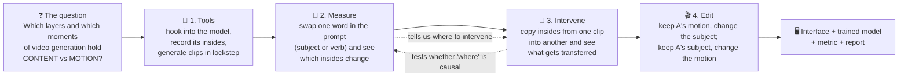

**The main results in five lines:**

1. **When:** motion is decided in the **first 2–3 of 25 denoising steps**. This is the clearest finding (H2 survived its test).
2. **Where:** the motion signal is strongest in **one deep decoder block (`up_blocks.0`)**, but only weakly. Content dominates almost everywhere. Our layer prediction (H1) was wrong by one block, and in a replication across 4 model variants (Experiment 2) the signal leans the same way but is not statistically significant.
3. **How:** splitting a layer's output into "the average over frames" and "what changes between frames" does **not** cleanly separate content from motion (H3 failed). The frame average still carries motion.
4. **Editing:**
   - Our own surgical edits (copying one part of a layer) helped on average but **missed the pre-set success bar**.
   - Copying the model's **temporal attention** (how each pixel looks across frames) is what works for motion transfer.
   - Swapping motion and appearance **between two clips** (Stage 6b "dual" edits) **passes the bar on all 12 test pairs**,
     in both directions. Editing from one clip plus a prompt transfers the motion but also leaks some of A's look.
5. **Lesson:** *where information can be read* (probes) and *where it can be used to edit* (patching) are **different places**. This shows up again and again.

---

## 1. The question, in plain words

The model makes a 16-frame clip from a sentence like **"a golden retriever running on a beach"**.

- **Content** (appearance) = *what* is shown: the dog, its fur colour, the beach.
- **Motion** = *how things move*: the running gait, the path across the frame.

If the model keeps these two apart internally, we should be able to:
- **keep the motion, change the content:** the same run, but by a horse;
- **keep the content, change the motion:** the same dog, but walking.

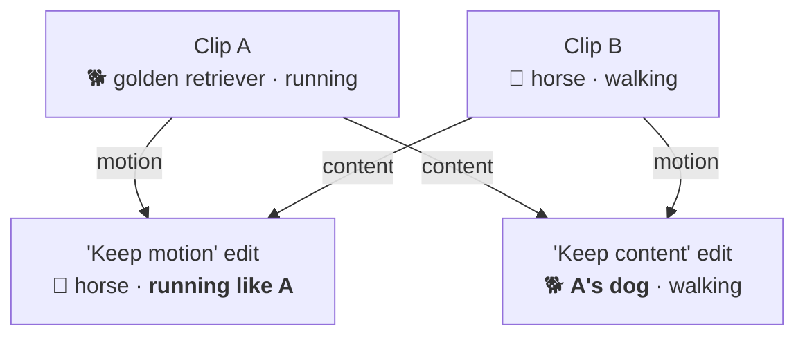

These two directions, **motion direction** and **content direction**, appear throughout the project.

---

## 2. The model and how it makes a video

We use **AnimateDiff**: the well-known image model **Stable Diffusion 1.5**, plus small **motion modules** inserted into it. These were trained on video and let frames "talk" to each other. We chose it because it is small and open and fits a free GPU: 16 frames at 512×512, about 65–90 s per clip on a T4.

### 2.1 Making a clip = removing noise in 25 steps

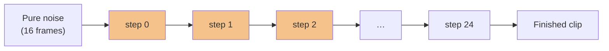

At each step the network (a **U-Net**) predicts a bit of noise to remove. The orange steps, the first three, turn out to be where motion gets fixed (§4.4).

**Seed** = the starting noise. Two clips with the same seed start from the same noise, so their layout tends to be similar. We use this a lot: pairs of clips share a seed, so the only difference between them is the prompt word.

### 2.2 Inside the U-Net

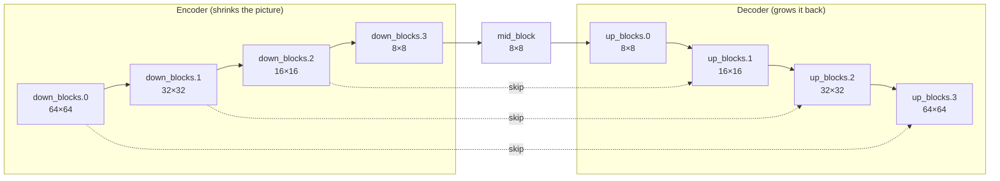

Each block has two kinds of layers:

| Layer type | Looks across… | Expected to hold | Count |
|---|---|---|---|
| **Spatial** self-attention (`attn1`) | the pixels of **one frame** | appearance, layout | 16 |
| **Spatial** cross-attention (`attn2`) | the **words of the prompt** | which word goes where | 16 |
| **Temporal** motion module (and its 2 attention layers) | **the same pixel across all 16 frames** | motion | 21 modules (+21+21 attention) |

Together that is **95 places we can "plug in"**. We call them *coordinates*.

> **Why AnimateDiff videos "drift":** the motion module only connects *the same pixel position* across frames.
> A dog that moves to a new spot is never matched to itself, so its fur and face can morph between frames. This is a
> known limitation of the architecture; newer models use full 3-D attention. Details and sources are in
> [`code/docs/report_notes.md`](code/docs/report_notes.md). We compared 4 model variants for this
> (`code/results/kaggle/vdprobe-xattn/out/variants_contact_sheet.png`): the epiCRealism + v3 combination keeps the dog's
> identity best, but the dog barely moves.

---

## 3. Deliverable 1 · The tools

**Goal:** be able to look inside the model while it generates, and change things inside it, without breaking anything.

### 3.1 What we built (package `code/src/vdprobe/`)

| Tool | What it does in simple terms | File |
|---|---|---|
| Coordinates | A list of the 95 places to plug in, with their block and resolution | `coords.py` |
| Hooks / harness | "Taps" on those layers that record or modify their output at a chosen step | `harness.py` |
| **Lockstep sampler** | Generates several clips **side by side, one step at a time** (explained below) | `lockstep.py` |
| Patcher | Copies a layer's output from one clip into another at chosen steps | `patching.py`, `edit.py` |
| Attention injection | Copies *attention patterns* (who looks at whom) from one clip into another | `edit.py` |
| Metrics | Optical flow (motion), CLIP similarity (content), the D score | `metrics.py` |

### 3.2 The lockstep trick (why it matters)

To compare clip A and clip B *inside* the model, you need both clips' internals for the same step at the same time.
Saving all 25 steps of one clip would take about 7.6 GB per clip. Instead we generate them together:

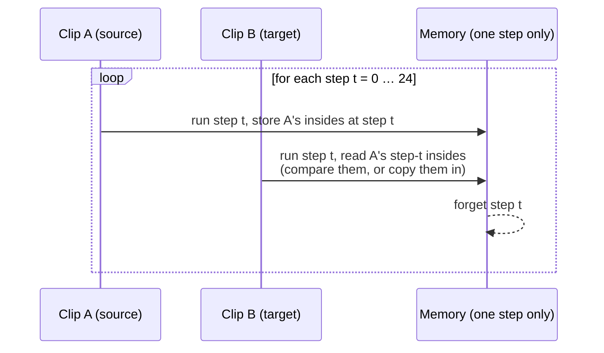

**Checked carefully** (`scripts/lockstep_check.py`):
- a clip made this way is **bit-for-bit identical** to the standard pipeline;
- clips running side by side don't leak into each other;
- recording changes nothing.

### 3.3 Safety checks for the "copying" tools (controls)

| Check | Expected | Got |
|---|---|---|
| Copy a clip's insides **into itself** (null patch) | no change at all | exactly zero change ✅ (two real bugs found and fixed on the way) |
| Copy from the **wrong step** (deliberate mistake) | must change the clip | changes it (PSNR 25 dB) ✅ |
| Copy A→B vs B→A (symmetry) | similar size both ways | A→B was 2× bigger ❌. Recorded as a failure; a running clip may simply carry more motion. |

**Status:** ✅ done and tested. The test suite has 87 tests. Early pilots (E1 speed and memory, E2 seed control, E3 extraction cost) are in the prep notebooks at the repo root.

---

## 4. Deliverable 2 · Measuring where content and motion live

### 4.1 The idea: change one word, see what moves

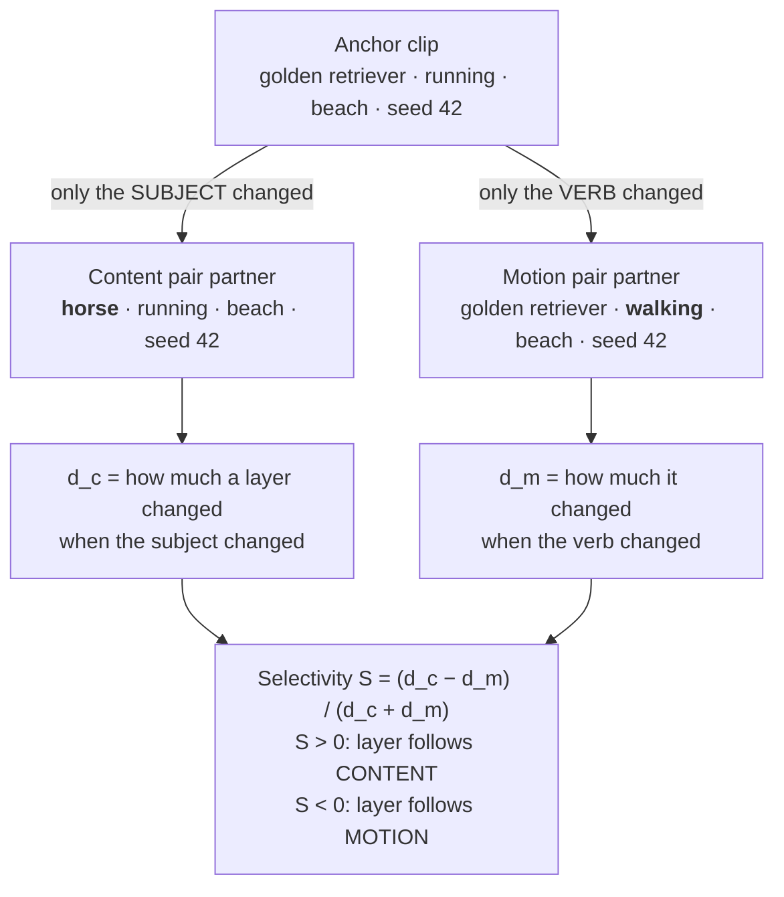

**The probing set:** 15 subjects × 4 verbs (running, walking, jumping, spinning) × 2 scenes (beach, forest) × 3 seeds
= **360 clips**, which give **750 pairs**. It ran on Kaggle in about 5 hours and produced 300,000 measurements (every coordinate × every step).

### 4.2 Splitting each layer's output into two parts

A layer's output has 16 frames. We split it into:

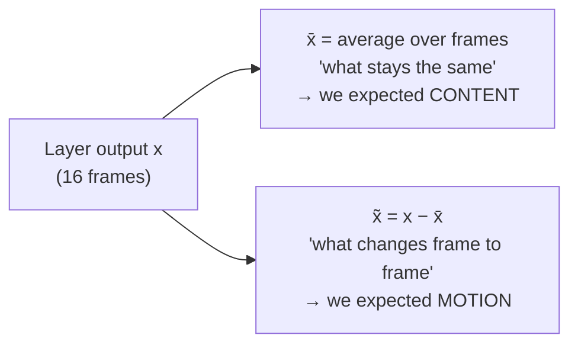

The same idea appears in the literature as **MOFT** (NeurIPS 2024): subtract the frame average to get a motion feature.

### 4.3 Three predictions, written down *before* looking at the data

We wrote the predictions and their tests down first. That way the result can't be bent to fit afterwards. This is the **pre-registration** idea, and the whole project follows it.

| | Question | Prediction | Result |
|---|---|---|---|
| **H1** | *Which layer* holds motion? | the medium-resolution decoder block, `up_blocks.1` | ❌ **Wrong by one block.** The peak is at `up_blocks.0` (8×8, deeper). It was the winner in 1000/1000 bootstrap resamples, but it is weak (M = +0.005). Every other block leans towards content. |
| **H2** | *When* is motion decided? | early in the 25 steps | ✅ **Survived.** The changepoint is at step 2 (95% CI [1, 3]). After about step 9, swapping the verb or the subject changes the insides equally. |
| **H3** | Is x̃ (frame changes) the motion part? | removing the frame average should turn layers motion-selective | ❌ **Failed.** It shifts every layer *towards* motion but never crosses into motion-selective. The frame **average** x̄ even carries the cleaner early motion signal. |

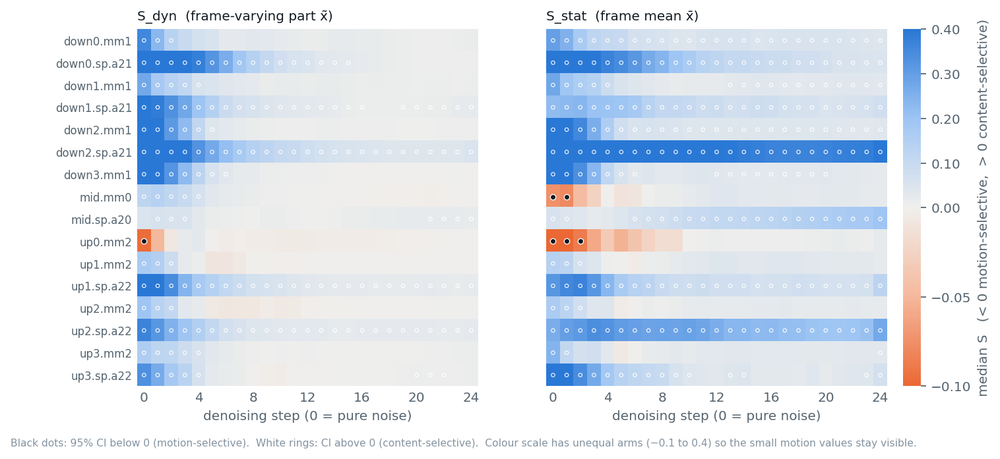
*Selectivity of 16 representative layers (rows) × 25 steps (columns). Blue = content, orange = motion. Almost everything is blue; motion shows up only top-left (deep decoder, first steps).*

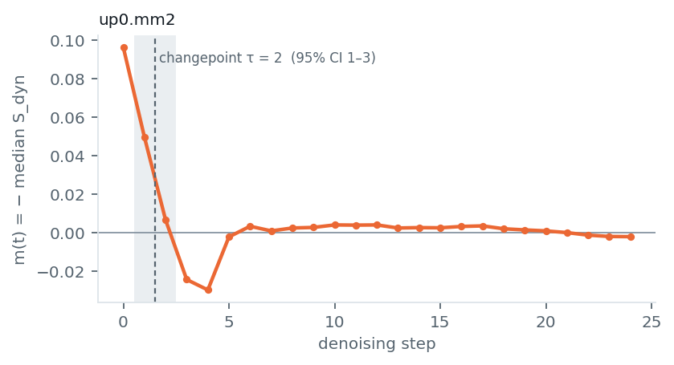
*H2: motion selectivity at `up_blocks.0` is high at steps 0–2 and then disappears.*

### 4.4 Probes: can a simple classifier read the verb off a layer?

We trained a linear classifier to guess the verb (4 choices, so 25% is chance) from each layer's x̃, training on one scene and testing on the other.
- Average **0.44**, best layers about 0.5–0.74. Some motion information is readable.
- **Caveat:** the cross-attention layers read the prompt directly, so "the verb is readable" there partly means "the verb word is in the prompt". This is called *prompt leakage*.
- Later we added proper controls (D-34: control tasks, non-linear probes, permutation tests), built on CPU. They can only run on the real data once the old sweep files are copied over (see §9).

### 4.5 Experiment 2 · Does it replicate on other models? (novelty phase, in progress)

We ran the same measurements on **4 model variants**: {SD1.5, epiCRealism} base × {motion adapter v2, v3}.

| Model variant | Does the `up_blocks.0`, steps 0–2 motion site replicate? (one-sided p) |
|---|---|
| SD1.5 + v2 (our main model) | leans the same way, not significant (p = 0.19) |
| epiCRealism + v2 | leans the same way, not significant (p = 0.06) |
| SD1.5 + v3 | leans the same way, not significant (p = 0.17) |
| epiCRealism + v3 | leans the same way, not significant (p = 0.06) |

In plain words: **the H1 "motion lives at up_blocks.0" result is fragile.** It points the right way in every model but isn't strong enough to call. The H2 timing result is the robust one.

Two analysis corrections were made (D-36) before anything was selected from these data: a leak in the decoding cross-validation, and a missing "text" reference in RSA.

**Status / left / ideas:**
- ✅ Main sweep, analysis, figures; Experiment 2 sweeps for all 4 variants; per-variant analyses.
- ⏳ Experiment 2, running or left (needs GPU quota; see `code/docs/experiment2.md`):
  - quality gate to pick the "primary" variant (running now);
  - the content ladder (gradually changing the subject);
  - patching the selected candidates (A→B, B→A, unrelated C→B);
  - **concept erasure** (LEACE: remove verb information from a layer and see if motion breaks);
  - a LoRA trained only on the selected layers vs random layers.
- 💡 Open questions noted, not tested: the seed explains a large share of x̃ (about 21–26%), which fits "appearance flicker shows up as motion". Comparing against per-clip identity consistency, or re-running with **FreeInit**, would tell.

---

## 5. Deliverable 3 · Intervening: copy insides from one clip into another

Measuring shows *where information is*. Intervening tests *whether the model uses it*. The basic move:

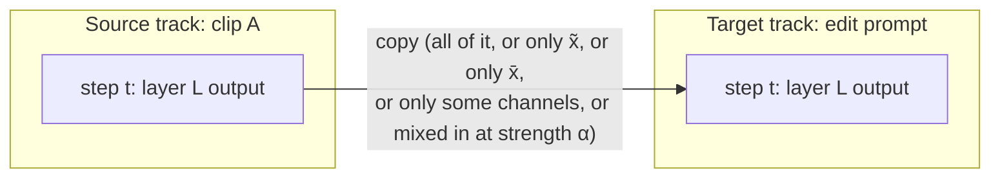

What we can copy, from coarse to fine:

| Granularity | What is copied | Plain meaning |
|---|---|---|
| 1 · whole tensor | the full layer output | "transplant the whole layer" |
| component (D-29) | only x̃, or only x̄ | "transplant only the moving part / only the still part" |
| 2 · channels | the most motion-selective channels | "transplant only the motion channels" |
| 3 · **temporal attention** | *who-looks-at-which-frame* weights | "copy the pattern of how each pixel follows the others over time" |
| 4 · strength α | a mix of source and target | "half-transplant" |

**Status:** ✅ done with controls (§3.3). Granularity 3 is our stand-in for **MotionClone** (ICLR 2025), whose official code needs gradient guidance that did not fit an 8 GB GPU (decision D-17).

---

## 6. Deliverable 4 · The editing demonstration

### 6.1 How an edit is scored

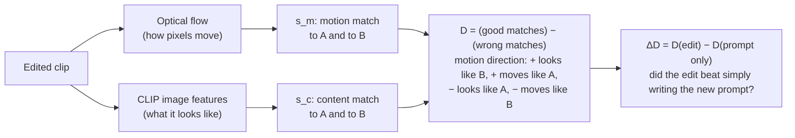

The **baseline every edit must beat is "just change the prompt"**, for example writing "a horse running" from the same seed. An edit only counts if it does better than that.

### 6.2 The fair-test recipe (pre-registration)

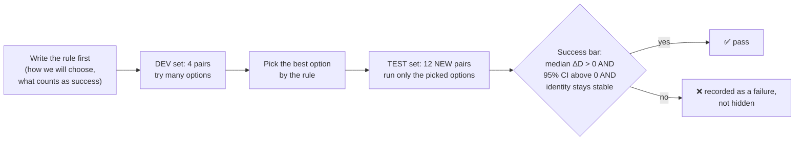

### 6.3 Stage 5–6 · Our own surgical edits (component patches)

- **Dev:** 51 options × 4 pairs, chosen by rule D-31.
- **Test:** 12 pairs.

| Method | Gain over prompt only | Held up statistically? |
|---|---|---|
| Copy the moving part (x̃), `up_blocks.3`, first third of steps (**motion edit**) | +0.041, better in 8/12 pairs | No (CI includes 0) |
| Copy the still part (x̄), `down_blocks.3`, first third (**content edit**) | +0.068, better in 10/12 pairs | No |
| Copy the whole tensor | negative: it copies all of A | No |
| **Temporal attention injection** (baseline) | **+0.105**, better in 10/12 pairs | **Yes, only just** |
| Prompt + motion LoRA (probe / full / wrong-place) | +0.023 / −0.021 / −0.020 | No |

In plain words: **our surgical patches help on average, but not by enough to pass the bar we set in advance. This is recorded as a failure.** Two honest findings:
- The layer the probes point to (`up_blocks.0`) is **not** the layer that edits best (`up_blocks.3`).
- Copying the "still" part (x̄) also copies motion. That fits H3 failing: the frame average is not motion-free.

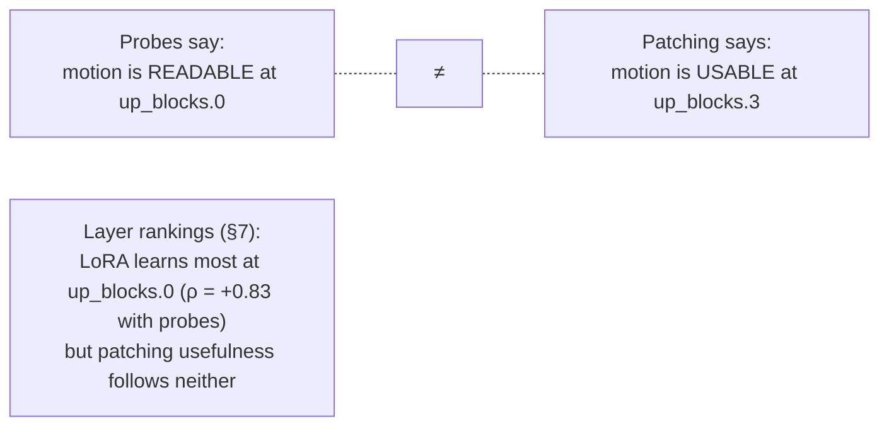

### 6.4 Why the surgical patches fall short, and what the literature does instead (research, 25 Oct)

| Paper | What it does | What it tells us |
|---|---|---|
| **MotionClone** (ICLR 2025) | guides generation to match the reference's **sparse temporal attention**, at `up_blocks.1` | motion lives in temporal attention, and you *guide* towards it rather than overwrite |
| **MOFT** (NeurIPS 2024) | the same "subtract the frame average" feature as our x̃, used as a **guidance loss** | our x̃ idea is right, but hard copying is the wrong way to use it |
| **UniEdit** (2024) | motion: inject **temporal attention at all layers and all steps**; content: inject spatial **values** from a reconstruction | inject over the *whole* trajectory, not just the first third |
| **MasaCtrl** (ICCV 2023) | the edited image's spatial self-attention reads the source's **keys/values** | transfers appearance while the target keeps its own layout and motion |

**Key insight:** our x̄/x̃ patches overwrite the **residual stream**, the main signal path that carries everything at once. Attention-level methods only change *what each position looks at*, and the target keeps its own "questions" (queries). That is a gentler, more selective transfer.

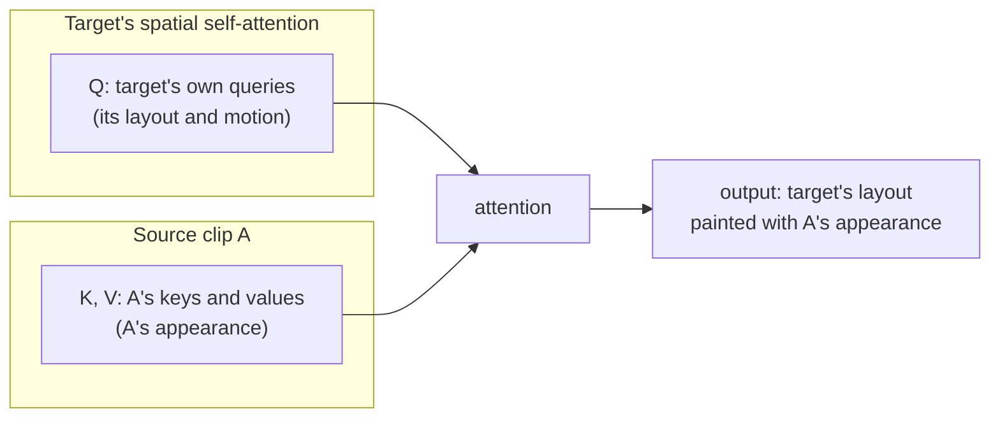

### 6.5 Stage 6b · Attention-level edits from the literature (D-37, built and run 25 Oct)

**What we built** (`edit.py`, `edit_plan.py`):
- **Key/value injection** (MasaCtrl-style) into spatial self-attention.
- **Temporal attention injection over all 25 steps** (UniEdit-style).
- **"Dual-source" edits:** appearance from one clip and motion from the other, at the same time.
- **Probe-placed versions:** the same operators, but placed where *our* maps point (`up_blocks.0` + mid at steps 0–2 for motion; `down_blocks.2` for content).

**Dev results (4 pairs; selected by rule D-37, which was written before running):**

| Direction | Selected method | Dev gain | Old best on dev |
|---|---|---|---|
| keep motion, from A only | temporal attention, **all modules, all steps** | **+0.152** (3/4 pairs) | +0.080 |
| keep motion, dual | that + B's keys/values (`up_blocks.2–3`) | +0.147 (4/4) | – |
| keep content, from A only | **K/V at `down_blocks.2` (our probe-placed arm)** | **+0.056** (3/4) | +0.015 |
| keep content, dual | A's K/V + B's temporal attention | +0.121 (3/4) | – |

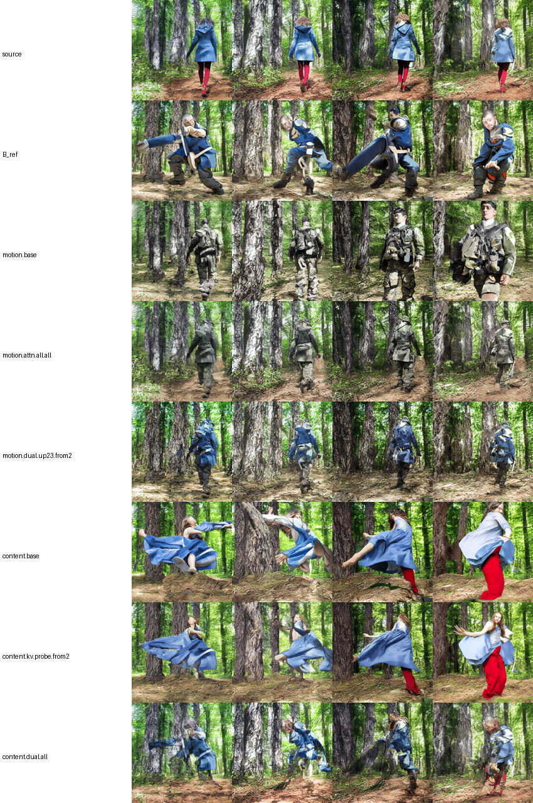
*Rows: source A (young woman walking), B (soldier spinning), prompt-only edits, and the selected attention edits; columns are frames 0/5/10/15. "motion.attn.all.all": a soldier walking away along exactly A's path and framing.*

**What we saw in the clips (honest):**
- ✅ Motion transfer **works** on woman→soldier and fox→German shepherd: B's subject follows A's path.
- ❌ On child→elderly man the output is still A's child (A's appearance leaks along with the motion). On bear→retriever the dog is ghostly and see-through.
- **The probe-placed content arm beat the paper defaults.** MasaCtrl's default placement drags A's motion along too.
- **Probe-placed motion arms did nothing.** Motion transfer needs *all* temporal attention, not just where the probe points. This is the same presence-vs-use gap again.
- ⚠️ **Dual arms are partly circular:** they inject from clip B and are then scored against clip B. They are reported separately, as "compositing two clips", not as prompt-only editing.

**Test (12 held-out pairs, one comparison pool with the old arms):**

| Method | Family | Gain | Pairs better | Passes the bar? |
|---|---|---|---|---|
| Keep motion: temporal attention, all steps | from A only | +0.097 | 10/12 | ❌ (CI [−0.02, 0.19]) |
| Keep motion + B's look via K/V | **dual** | **+0.173** | **12/12** | ✅ CI [0.11, 0.27] |
| Keep content: K/V at `down_blocks.2` (probe-placed) | from A only | +0.022 | 8/12 | ❌ |
| Keep content + B's motion via temporal attention | **dual** | **+0.145** | **12/12** | ✅ CI [0.10, 0.28] |
| Old attention baseline (first third) | from A only | +0.096 | 9/12 | ❌ in this pool |

In plain words:
- **Swapping motion and appearance between two clips works**, reliably, in both directions, on every test pair.
- **Editing from clip A plus a new prompt transfers the motion well but still drags some of A's look along**, so it
  doesn't clear the bar.
- Pictures are in `code/results/figures/stage6b_test/` (one sheet per pair). Pick demo clips **by eye**: one pair scores
  high D while the clip is just sand and a boot. Clean examples are athlete→soldier (test), and woman→soldier and
  fox→German shepherd (dev).

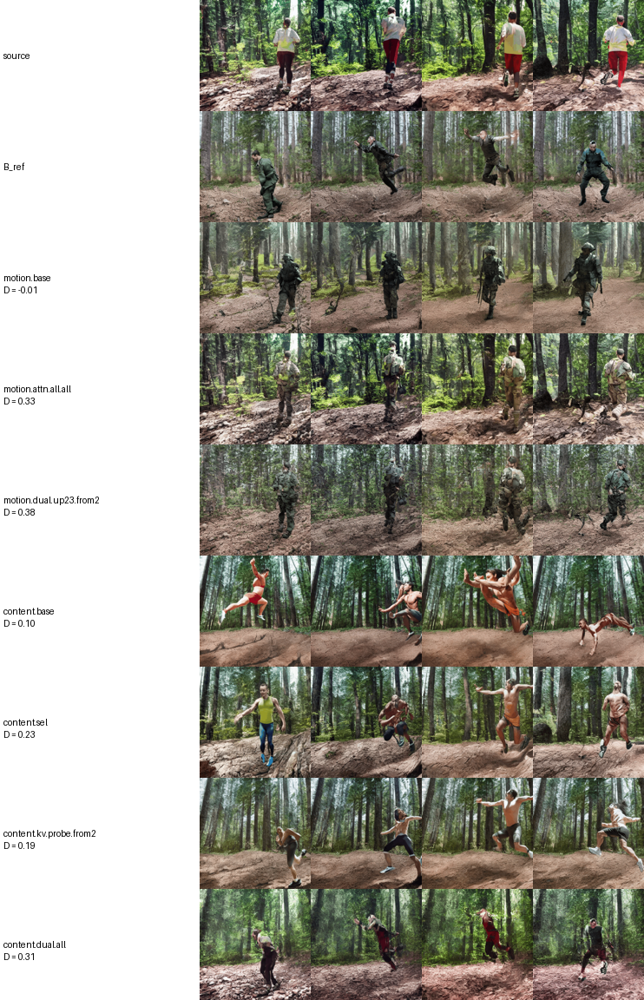
*Test pair athlete (walking) → soldier. Row 4 ("motion.attn.all.all"): a soldier walking away along exactly the athlete's path.*

**A note on the score:** D is rescaled within each run's pool of clips, so the *same* clip can score differently
in a different run. For example, the old content patch clears the bar in this pool but not in the Stage 6 pool. The
Stage 6 verdict stays as originally recorded.

### 6.6 Stage 6c · Prompt switching timed by H2 (other session, D-38)

The idea: if motion is decided in the first ~2 steps (H2), then **start with A's prompt and switch to the new prompt at step τ**. Motion should come from A and content from the new prompt, with no surgery at all.

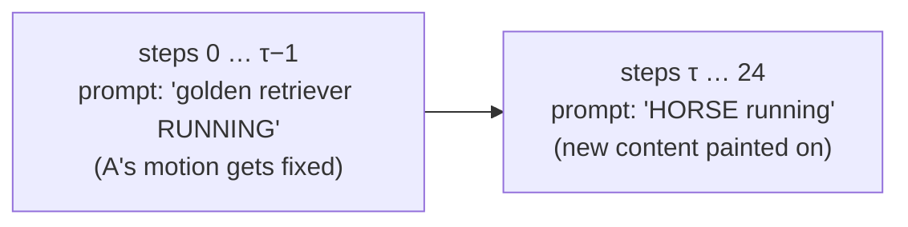

There is also a **masked** version that only switches inside A's subject outline, using cross-attention maps (after EIDT-V, CVPR 2025).

| Arm | Gain | Held up? |
|---|---|---|
| switch at τ = 2 (pre-registered from H2), motion / content | +0.040 / +0.064 | No |
| masked switch at τ = 2 | +0.011 | No |
| content direction, switch at τ = 3 / τ = 5 (exploratory) | +0.076 / +0.096, better in 11/12 pairs | **Yes** (exploratory, not pre-registered) |

The motion kept from A rises smoothly with τ, with **no sharp turn at τ = 2**. So H2's timing does not translate directly into a sharp switch point. Figures are in `code/results/figures/switch/`.

**Status / left / ideas for editing:**
- ✅ Stages 5, 6, 6b dev, 6c test.
- ✅ Stage 6b test: dual-source passes in both directions (12/12); single-source does not.
- 💡 Looked into, not built:
  - **gradient guidance** (MotionClone/MOFT style: nudge the noise each step so the edit's temporal attention matches A's). Most likely to beat injection, but needs backpropagation through the U-Net at each step (memory and time).
  - **DAAM-masked attention injection** (inject motion only on the subject's pixels). This could fix the "motion lands on the scene, not the subject" problem from the upload tab.
  - channel-selected x̃ patch; sparse top-k attention (MotionClone's actual mask).
  - DMT (space-time feature loss) needs optimisation, so it is too slow for this budget.

---

## 7. The trained model: motion LoRAs

The brief asks for a trained or fine-tuned model. We trained three small **LoRA** adapters (cheap fine-tuning add-ons) on about 20 real clips from HMDB51 (run / walk / jump / turn):

| Variant | Trained where | Why | Held-out loss |
|---|---|---|---|
| **probe** | only `up_blocks.0` (where probes point) | test "train where the motion is" | 0.0652 |
| full | all motion modules | the normal way | 0.0638 |
| anti | `down_blocks.2–3` (least motion-selective) | "wrong place" control | 0.0646 |

- None of them improves editing significantly (§6.3). The probe-guided LoRA is the best of the three (+0.023).
- **Layer rankings:** the full LoRA changes most at `up_blocks.0`, exactly where probes peak (Spearman ρ = +0.83, p = 0.005), so *learning* follows *presence*. Patching usefulness follows neither.
- ⚠️ **11 of 19 training clips contain hard scene cuts**, so part of what the LoRAs learned is cuts. All three variants used the same data, so the comparison is fair, but this is a weakness.

**Status / left / ideas:**
- ✅ Trained, evaluated, ranked.
- 💡 Planned, not run: a cut-free retrain × 3 seeds.
- ⏳ Experiment 2's LoRA pilot is queued (cartwheel clips with a debiased loss; target layers chosen by RSA vs 19 random layer sets).

---

## 8. The interface (Gradio app)

`code/scripts/app.py`. It runs on a GPU, or in browse-only mode with `--no-gpu`.

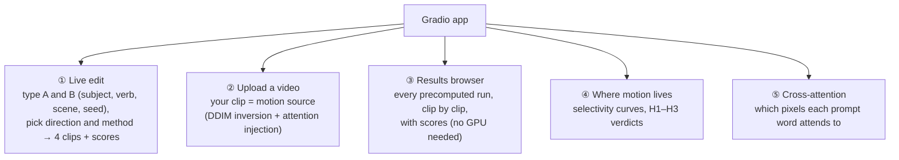

- **Methods in the live tab:** selected patch, custom patch, attention injection (first third / all steps), whole tensor, the three LoRAs, and since today **"attention edit from A only"** and **"dual"** (Stage 6b).
- **Upload tab, the hard part:**
  - the first version gave noise, because real-video internals don't line up with a freshly generated clip;
  - the fix is attention injection over all steps, starting from a blend of the inverted noise and fresh noise;
  - limitation: the motion sometimes lands on the *scene* (a pillar grows) instead of the *subject*.
- **Design:** accessible colours (checked contrast in light and dark), plain-language labels, play/pause clips, step-by-step progress.

**How to run:**
- Locally: `cd code && env -u PYTHONPATH .venv/bin/python scripts/app.py` (add `--no-gpu` to browse only).
- On Kaggle with a public link: notebook `code/notebooks/run_interface_kaggle.ipynb`.

**Status / left:**
- ✅ Built; all tabs checked in a browser.
- ⏳ The new Stage 6b methods have not been run live on a GPU yet (unit-tested only).
- ⏳ The old Stage 6 dev/test runs are not on this machine (they are on the previous Kaggle account), so the browser shows the Stage 6b runs and a local smoke pair.

---

## 9. What is left: one list

| Priority | Item | Status | Needs |
|---|---|---|---|
| ✅ | Stage 6b test results → score, verdict, demo clips | done (§6.5) | – |
| 🔴 | Run the new methods once live in the interface (GPU check) | not done | ~15 min GPU |
| 🔴 | Final README pass + submission packaging | partly done | CPU |
| 🟠 | Experiment 2: quality gate → patching → erasure → content ladder → LoRA pilot | quality gate running; rest queued | many GPU hours (the quota is the limit) |
| 🟠 | Copy the old sweep outputs from the previous Kaggle account (needed for the D-34 probe controls on real data, and for the results browser's Stage 6 runs) | not done | account access |
| 🟡 | Report and slides (**written by the team**; notes in `code/docs/report_notes.md`) | not started | team |
| 💡 | Gradient guidance (MotionClone/MOFT), masked injection, cut-free LoRA retrain, FreeInit | ideas only | GPU and time |

**Dates:**
- Stage 1 submission: 25 Oct 23:59 IST.
- Presentations: 26–31 Oct.

---

## 10. Where things are

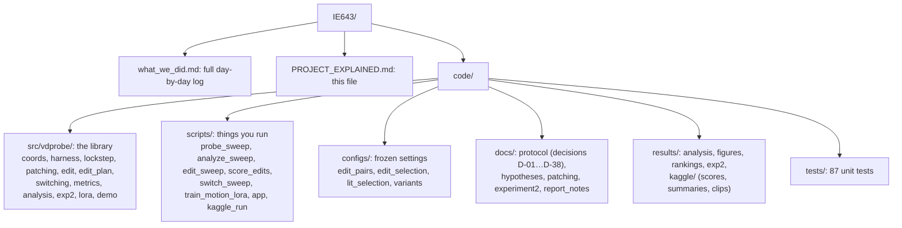

- **Not in git** (too big, 12.6 GB): the raw per-clip tensors (sketches, channel stats). They can be re-downloaded from the Kaggle kernels with `scripts/kaggle_run.py --slug <run> --download-only`.
- **Branch:** `final-submission`, auto-pushed every 15 min.

---

## 11. Glossary

| Term | Meaning |
|---|---|
| **Denoising step** | One of the 25 rounds in which the model removes noise. Early steps set the layout and motion; later steps set the details. |
| **Seed** | The random starting noise. The same seed gives a similar layout. |
| **U-Net block** | One stage of the network. `down` = shrinking, `up` = growing back, `mid` = the bottom. |
| **Spatial / temporal layer** | Looks within one frame / across the 16 frames. |
| **Attention (Q, K, V)** | How a position decides what to look at: its **query** is matched against everyone's **keys**, and it collects their **values**. |
| **Activation** | A layer's output: the model's internal "thoughts" at that point. |
| **x̄ / x̃** | Average over frames / what changes from frame to frame. |
| **Selectivity S** | Does this layer react more to a subject change (S > 0) or a verb change (S < 0)? |
| **Probe** | A simple classifier trained to read a property (e.g. the verb) out of a layer. |
| **Patching / injection** | Copying a layer output / attention pattern from one clip into another during generation. |
| **Dev / test split** | Choose on dev, judge on test, so we can't fool ourselves. |
| **Pre-registration** | Writing down the rules and success criteria before seeing the results (`protocol.md`). |
| **ΔD, CI** | Gain over prompt-only editing; 95% confidence interval (if it includes 0, the gain might be luck). |
| **LoRA** | A small, cheap fine-tuning add-on to a big model. |
| **DAAM** | Maps of which pixels each prompt word attends to (from cross-attention). |
| **DDIM inversion** | Running the generator backwards to turn a real video into the noise that would produce it. |
