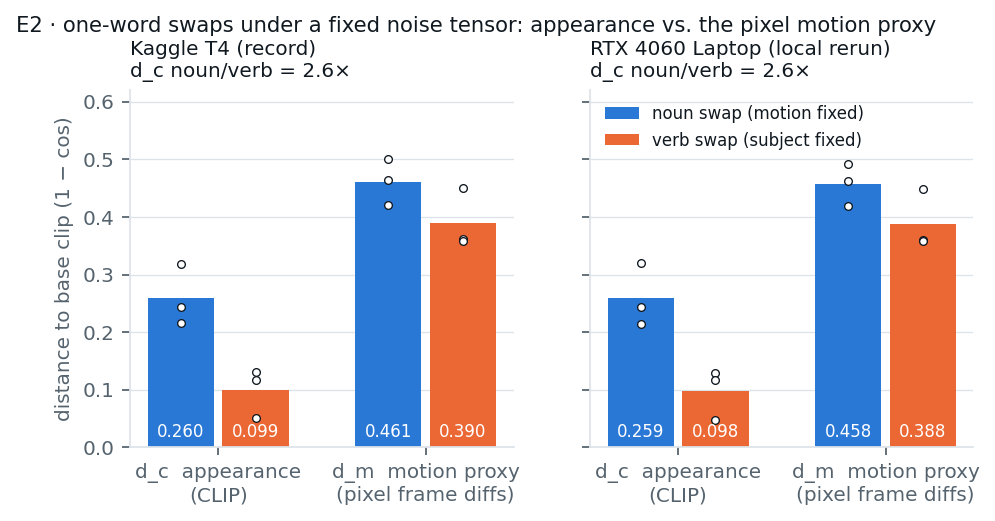

# Pilot phase (E1–E3), before the prep presentation

Moved here from the README on 2026-10-24; text unchanged except the image path.

Every experiment runs at the frozen protocol: AnimateDiff (SD1.5 +
`guoyww/animatediff-motion-adapter-v1-5-2`), 16 frames, 512×512, 25 DDIM steps, fp16,
CFG 7.5, diffusers 0.40.0, torch 2.10.0. **Record** is the Kaggle T4 run behind the prep
deck (`results/kaggle_t4/`, notebooks in `notebooks/kaggle_pilots/`). **Local** is the
same code re-run here (`results/local/`).

### E1 · Can we generate video at all, and at what cost?

| | Kaggle T4 (record) | RTX 4060 Laptop 8 GB (local) |
|---|---|---|
| wall clock per clip | 94.1 ± 0.1 s | 66.1 ± 1.2 s |
| peak VRAM (reserved) | 10.17 GB | 6.42 GB |
| 360-clip probing set | 9.4 GPU-h | 6.6 GPU-h |

Memory-config sweep (`--config-sweep`, as in the notebook):

| config | Kaggle T4 | RTX 4060 Laptop |
|---|---|---|
| fp16, no VAE slicing | 97.6 s, 14.09 GB | out of memory |
| fp16 + VAE slicing (default) | 94.4 s, 10.16 GB | 65.2 s, 6.41 GB |
| fp16 + slicing + CPU offload | 95.9 s, 8.93 GB | 66.1 s, 5.33 GB |

The roadmap assumed the 8 GB laptop GPU could not run this configuration. On the same
software stack it does, with room to spare: the RTX 4060 (sm_89) has flash attention,
which the T4 (sm_75) lacks (D-27).

### E2 · Does a fixed noise tensor hold the clip still when one word changes?

Seven clips from one fixed CPU-drawn noise tensor: the base *"a golden retriever running
on a beach"*, three noun swaps (motion held fixed) and three verb swaps (subject held fixed).

| mean over the three swaps | Kaggle T4 (record) | local |
|---|---|---|
| `d_c` appearance (1 − CLIP image cos), noun swaps | 0.260 | 0.259 |
| `d_c` appearance, verb swaps | 0.099 | 0.098 |
| **noun / verb appearance shift** | **2.6×** | **2.64×** |
| `d_m` pixel motion proxy, noun swaps | 0.461 | 0.458 |
| `d_m` pixel motion proxy, verb swaps | 0.390 | 0.388 |
| layout SSIM (frame 0), noun / verb | 0.367 / 0.400 | 0.368 / 0.400 |

The local per-clip values match the record to about three decimals (same CPU-drawn noise
tensor and pinned software, different GPU).

**Reading.** The content side of the control works: swapping the noun moves appearance
far more than swapping the verb. The motion side fails, and that failure is the result.
A noun swap holds the motion fixed, yet the pixel motion proxy moves *more* under noun
swaps than under verb swaps, and *standing* (no locomotion at all) scores no differently
from a change of animal. Frame-difference maps sit on the object's silhouette, so
changing what is depicted relocates them: the motion measurement is confounded by static
content. That is H3 appearing in pixel space before any activation was probed, and it is
why motion selectivity is defined on the frame-mean-removed residual (D-01, D-02). The
pass condition written into the notebook (mean S > 0 for nouns, < 0 for verbs) therefore
does not hold. The roadmap's response is D-05: content pairs are drawn within a body-plan
family.

### E3 · Can we get activations out, and what does storing them cost?

| | Kaggle T4 (record) | local |
|---|---|---|
| hookable coordinates | 95 (21 motion modules, 21 + 21 temporal attention, 16 + 16 spatial attention) | 95 (same split) |
| UNet calls per clip | 25 | 25 |
| full fp16 dump, every coordinate × step | 87.89 GiB / clip | 87.89 GiB / clip |
| summary store | 44.62 MiB / clip (analytic) | 44.62 MiB analytic, **44.66 MiB on disk** (written and re-read) |
| reduction | 2,017× | 2,017× analytic, 2,015× on disk |
| hook overhead, metadata only | +0.6 % | −0.9 % (noise) |
| hook overhead, full summary recorder | (not measured) | **+72 %** (110 s vs 64 s) |

The Kaggle notebook computed the summary size from the formula; here the
`SummaryRecorder` actually writes the store (`summary.safetensors` + `manifest.json`), and
the on-disk size is checked against the formula. The ratio compares a dump of both CFG
branches with summaries of the text-conditional branch; against a conditional-only dump
it is 1,008×. See [docs/harness.md](docs/harness.md).

**A cost the record did not measure.** Metadata-only hooks are free, but the full recorder
adds 72% to generation time. The likely cause is recomputing attention probabilities for
the 74 attention maps (SDPA never materialises them); the channel statistics are cheap
reductions, but the split has not been profiled. That lifts the 360-clip probing set
from 6.6 to about 11 GPU-hours on this GPU, so the roadmap's budget line built on "+0.6%
hook overhead" needs revising. The cheapest lever is the 64×64 spatial self-attention maps
(subsample their queries), or `attention_maps=False` for a statistics-only pass.

